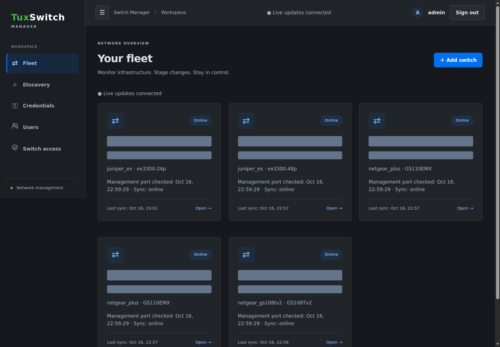
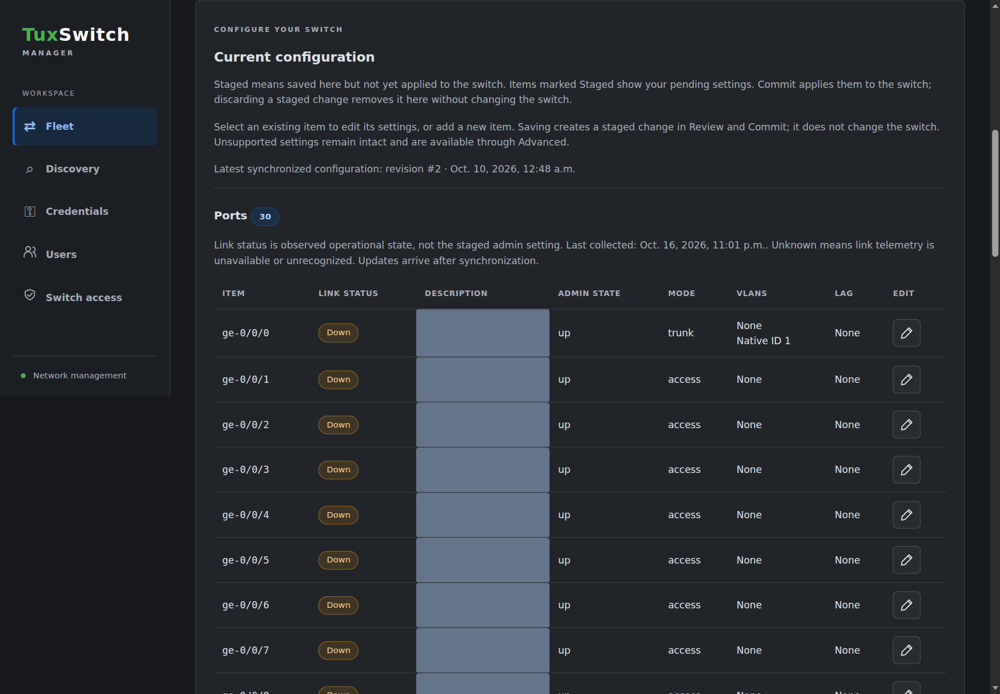
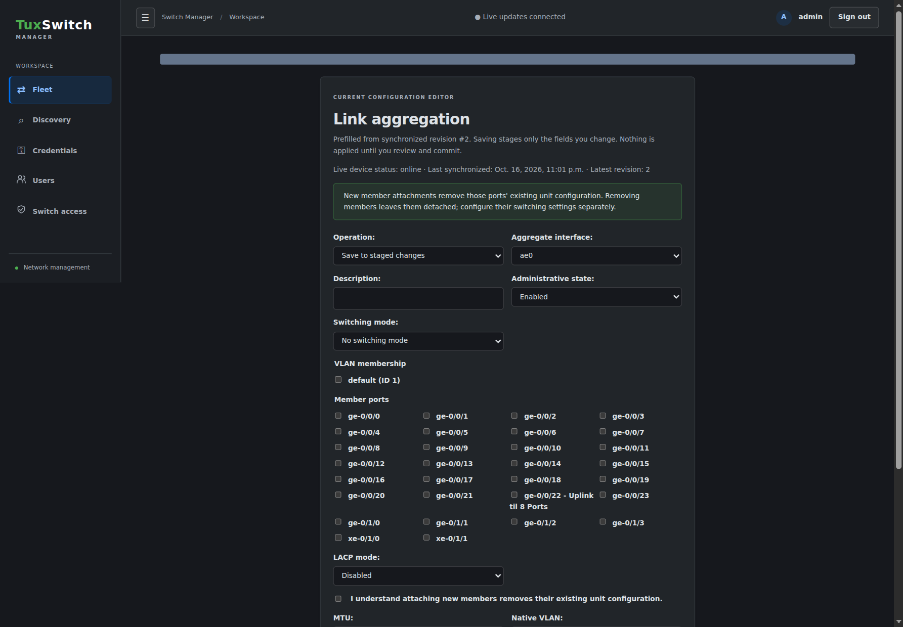
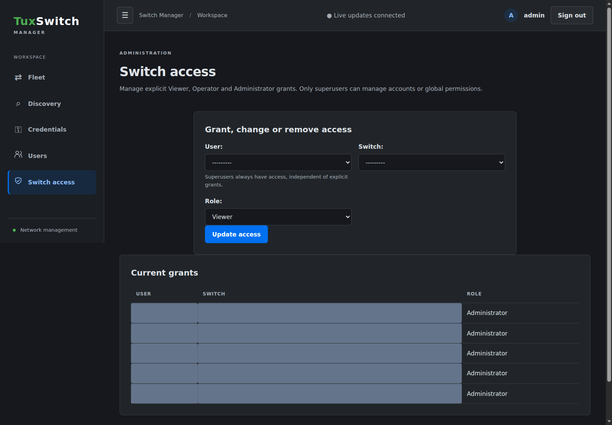

# Tux Switch Manager

A multi-switch management application built with Python, Django, Celery/Beat and
Django Channels. [Switchman](https://github.com/MrMEEE/switchman) is the functional reference; there is intentionally
no switch image, faceplate mapping or image-detection integration. Implemented
profiles cover Juniper EX3300, NETGEAR GS108Tv2 and GS110EMX, and experimental
HP V1910 / Comware 5 support; validation status is listed below.

## Screenshots

Captured from the running application. Network identifiers, interface descriptions
and account details are masked where appropriate; no configuration or access
changes were submitted to create these screenshots.

### Fleet overview

See device reachability, supported profiles and the latest synchronization times
in one place.



### Ports

Check observed link status alongside configured administrative state, VLAN
membership and link aggregation assignments.



### Link aggregation editor

Choose member interfaces, VLAN membership and LACP settings. Saving stages the
change for review rather than applying it immediately.



### Switch access

Manage per-switch Viewer, Operator and Administrator grants independently of
global account permissions.



## Features

- Fleet inventory, per-device access and cached operational/configuration views.
- System, interface, VLAN, LAG, static-route, security and service configuration;
  validated manual `set`/`delete` commands for advanced settings.
  LAG member selectors show interface descriptions alongside interface names
  when creating or editing an aggregate.
  The Ports overview shows observed Up/Down/Unknown link status separately from
  staged administrative settings, refreshed through WebSockets after each sync.
- Stage changes, preview and commit or discard. Immediate apply is disabled.
  Configuration tables show locally planned values with a **Staged** pencil badge,
  including new items and deletions. Review staged items before committing;
  discard restores the synchronized display. Stale-baseline, uncertain or
  unsupported local projections show explicit warnings instead of guessed values.
  The display is local only and does not modify synchronized snapshots or devices.
  Pending GUI changes can be reopened with **Edit staged change**; the form
  prefills the staged values and saving replaces the same change, rather than
  adding another. Opening the ordinary editor for that same object also resumes
  its pending change, including all previously saved settings. Save, Cancel and
  Back return to the configuration section being edited (for example, Ports or
  VLANs), rather than switching to Review and Commit. Saving combines
  the intended settings into one change generated against the synchronized
  configuration revision, not a concatenation of conflicting command batches.
  Older tabs cannot create duplicates or overwrite a pending change without
  its current edit token; live updates flag those editors as outdated.
  Different objects remain separate. Running, uncertain and outdated changes
  are not merged. Existing duplicate records require explicit review and
  discarding duplicates; they are never silently combined or deleted.
  **Remove staged item** discards an addition; **Revert staged
  change** discards an edit/deletion and restores the synchronized display.
  These actions discard the whole staged change, including related items, and
  never write to the switch. Running, uncertain and outdated changes cannot be
  edited; use Verify outcome for uncertain changes before creating replacements.
  Older manual multi-item batches may require discarding the pending change and
  saving separate new staged changes through Current configuration.
  Configuration-table actions use compact review, edit, remove and revert icons
  with hover tooltips and accessible labels.
  Confirmations use in-app modals with Cancel/Escape support, not browser
  JavaScript popups. Confirmation preserves the selected form action, while
  live updates defer replacing the form until the dialog closes.
  Junos provides a device-generated diff and commit-check; the legacy NETGEAR
  adapter provides a local planned diff and managed-field readback instead.
- Monitor chassis, health, interfaces, switching, routing, BGP, OSPF, ARP, MAC,
  LLDP, PoE and alarms. Optional SNMPv2c IF-MIB polling supplies interface names,
  administrative/operational status and 64-bit traffic counters.
- Background synchronization, command history, ping, traceroute and reboot.
- RBAC-controlled discovery without credentials lists management-service candidates
  with detection evidence. Assign credentials to verify and enroll supported switches.
- Reusable username/password credentials, encrypted at rest, with a permission-gated
  management page. Existing environment-variable credentials remain supported.
- Permission-filtered WebSocket notifications update cached data and job history
  without replacing configuration forms that users are editing.
- Authenticated WebSockets push live discovery progress/results, fleet inventory
  and status, switch telemetry/history, job output, credential lists and credential
  choices. No manual refresh is needed. Discovery history expansion and unsaved
  form values are preserved; updates to focused controls are deferred until blur.
  Disconnections reconnect automatically with backoff, and a 30-second WebSocket
  resynchronization rechecks sessions and permissions. Revoked access clears the
  affected live region instead of retaining sensitive data. The page shows the
  connection state; ordinary HTTP polling is not used.
- Encrypted configuration revisions, adjacent-revision diffs and restoration.
  Revisions are created when the configuration changes, including out-of-band
  changes detected by polling. Commits and restores record their initiating user.
- A vendor-independent driver contract and settings-based plugin registry.
- Juniper NETCONF, NETGEAR legacy/Plus web profiles, and experimental HP V1910
  SSH2 support, with profile-specific capabilities and safety warnings.
- A responsive dark workspace matching TuxCMDB's sidebar, blue accents and green
  Tux branding, with collapsible navigation and locally served theme assets.

## Supported switches

All four implemented driver profiles are listed below. Live collection testing
does not certify every configuration write; see each model's notes for the exact
validation scope, setup instructions and limitations.

| Switch / model | Profile and transport | Current testing status | Details |
| --- | --- | --- | --- |
| Juniper EX3300-24P | `juniper_ex` · NETCONF over SSH | Live synchronization tested; automated configuration/transaction tests | [Juniper EX](docs/juniper-ex.md) |
| Juniper EX3300-48P | `juniper_ex` · NETCONF over SSH | Live synchronization tested; automated configuration/transaction tests | [Juniper EX](docs/juniper-ex.md) |
| NETGEAR GS108Tv2 | `netgear_gs108tv2` · legacy web GUI | Live collection; automated managed-write tests | [GS108Tv2](docs/netgear-gs108tv2.md) |
| NETGEAR GS110EMX | `netgear_plus` · web GUI | Live collection and reversible name change; port/VLAN writes not live-tested | [GS110EMX](docs/netgear-gs110emx.md) |
| HP V1910 Comware 5 family (8/16/24/48G, including PoE variants) | `hp_comware` · SSH2 CLI | Experimental; fixture-tested, live compatibility unverified | [HP V1910](docs/hp-v1910.md) |

Other models are not implied to be compatible. Automatic matching recommends a
profile; authenticated model validation is still required. See
[profile matching and capabilities](docs/switch-profiles.md).

## Run locally

Requires Python 3.12+ and Redis. Install Redis using your operating system's
package manager. The launcher can start Redis as your own user without sudo;
for the manual terminal commands below, start Redis separately.
Run these commands from the repository root:

```sh
python -m venv .venv
. .venv/bin/activate
pip install -r requirements.txt

export DJANGO_DEBUG=1
export DJANGO_SECRET_KEY="$(python -c 'import secrets; print(secrets.token_urlsafe(64))')"
export CONFIG_ENCRYPTION_KEY="$(python -c 'from cryptography.fernet import Fernet; print(Fernet.generate_key().decode())')"
export DJANGO_ALLOWED_HOSTS=localhost,127.0.0.1
export REDIS_URL=redis://127.0.0.1:6379/0
export SWITCH_KNOWN_HOSTS="$HOME/.ssh/known_hosts"

python manage.py migrate
python manage.py createsuperuser
python manage.py runserver 127.0.0.1:8000
```

In two additional terminals, activate the virtual environment and supply the
**same** environment (including both keys and the switch credentials):

```sh
celery -A tux_switch worker --loglevel=INFO
celery -A tux_switch beat --loglevel=INFO
```

Alternatively, use `./tux-switch-manager` to manage the web server, worker and
Beat together. It loads its settings from `config/config.conf` (or the file
named by `TUX_SWITCH_CONFIG`); variables already exported in the shell are used
when no configuration file exists. Create the file from the sample, fill in the
keys and credentials, and keep it private:

```sh
cp config/config.conf.sample config/config.conf
chmod 600 config/config.conf
./tux-switch-manager manage migrate
./tux-switch-manager manage createsuperuser
./tux-switch-manager start
./tux-switch-manager status
./tux-switch-manager restart
./tux-switch-manager stop
```

On `start`, `restart` and `manage`, the script creates `.venv` with `python3` if it is
missing (override the interpreter with `TUX_SWITCH_PYTHON`) and runs
`pip install -r requirements.txt` when a pinned requirement is missing or has a
different version. It writes process IDs to `.run/` and service output to `logs/`.
`start` and `restart` automatically apply database
migrations with `migrate --noinput` and collect CSS/JavaScript with
`collectstatic --noinput` before launching services; if either step fails, startup
aborts. Back up the database before restarting after an application update.
For an initial installation, run `./tux-switch-manager manage migrate` before
creating the superuser, or create the superuser after the first successful start. Use
`./tux-switch-manager manage <command> [arguments...]` for any Django management
command with the configured environment and project virtual environment.
Activating `.venv` alone does not load `config/config.conf` for direct
`manage.py` commands. The web server binds to `127.0.0.1:8000` by
default; override this with `TUX_SWITCH_BIND_HOST` and `TUX_SWITCH_PORT` when
needed. For production, use the deployment guidance below and do not expose
the development setup to an untrusted network.

The launcher reuses a responding Redis at `REDIS_URL`. If a local unauthenticated
`redis://` endpoint is unavailable, it starts `redis-server` under your user,
bound only to loopback with protected mode enabled. No sudo or system service
is needed. Install the `redis-server` binary separately if it is missing.
Remote, authenticated and TLS endpoints must be provided externally; the script
does not substitute another Redis when those endpoints fail.

Redis data is persisted with append-only files in `.redis/` (private and
git-ignored), its PID is stored in `.run/redis.pid`, and its log is
`logs/redis.log`. `stop` shuts down the app services before its own Redis;
it never stops an externally managed Redis. `status` identifies the user-owned
instance or reports external Redis connectivity.

If discovery reports that it could not queue, check `REDIS_URL` and
`logs/redis.log` / `logs/worker.log`. Submit a new scan after Redis is available;
failed runs are not automatically retried.

Visit `http://127.0.0.1:8000/`. Add a switch, grant access, then synchronize it.
Use **Users** (`/users/`) for superuser-only account creation, editing,
deactivation, password resets, group membership and direct application
permissions. Existing groups and their inherited permissions are retained.
Use **Switch access** (`/access/`) to assign or remove per-switch roles;
this requires `switches.manage_access`, not staff status. The Django admin
route is no longer exposed. Web mutations require authenticated sessions and CSRF
tokens; worker jobs recheck permissions before contacting devices.
Account editors preserve drafts, warn and block stale saves, and never send
stored passwords or hashes to the browser. Self-deactivation/demotion and
removing the last active superuser are blocked. Passwords use Django's
password validators; resetting a password invalidates that user's other
sessions. Account and access lists update through permission-filtered WebSockets.

Keep the generated keys stable between restarts. Store them in your deployment's
secret manager, not in source control. Losing `CONFIG_ENCRYPTION_KEY` makes stored
revisions, snapshots and job outputs unreadable. Back it up separately from the
database. Changing `DJANGO_SECRET_KEY` invalidates existing sessions.

### Pending changes and newer configuration revisions

**Staged** means saved in the application but not yet applied to the switch.
**Commit** applies the pending settings; **Discard**, **Remove staged item**
and **Revert staged change** remove a pending change locally without changing
the switch. The UI calls the configuration used to save a change its
**configuration revision**, rather than a "baseline".

When a newer revision is synchronized, an older pending change is not included
in the configuration table. The table shows synchronized settings for that
change instead. To recreate it safely:

1. Review its generated commands and note the intended settings.
2. Discard the old pending change using **Remove staged item** or
   **Revert staged change**.
3. Edit the item in **Current configuration** (or add it again), enter only
   settings still needed, and save a new staged change.
4. Review and preview the new change before committing.

There is no automatic "Restage" action: copying an old change onto a newer
configuration without review could overwrite newer settings. For uncertain
changes, use **Verify outcome** first; they may already be on the switch.

Bulk preview/commit/discard controls are shown only when pending changes exist.
Uncertain records remain visible with reconciliation instructions and cannot be
committed again. Removing an uncertain record clears only the local staged
record; it does not undo configuration already applied to the switch.

Use **Verify outcome** on an uncertain change for read-only reconciliation.
The worker synchronizes fresh device state and checks the intended settings,
without loading a candidate, applying commands or committing. Matching settings
resolve the record as committed with a **Verified applied** result in job history;
this confirms current state, not which operation caused it. Missing/conflicting
settings and unsupported comparisons retain the uncertain record and explain
the result in the workspace and verification job. After review, remove the
uncertain record and save a new staged change containing only missing settings
using the latest synchronized configuration; there is no automatic retry.
Verification results (time, revision, job and outcome) are encrypted at rest and
permission-filtered. Comparisons ignore unrelated device changes; managed
profiles compare the fields affected by their local plan, while supported Junos
commands are projected onto fresh XML and checked for remaining effects.
Startup persistence and operational link health are not certified by this check.

WebSocket regions cover fleet, discovery, credentials, inventory/credential
form data, device headings/actions, telemetry, configuration tables, staged
changes, revisions, job output, account details and permission-dependent
navigation. Focused controls no longer freeze unrelated live data. Updates
preserve typed drafts, checked choices, focus/cursor, expanded details and scroll
positions. Configuration editors receive live baseline/staged-change validity:
an outdated draft is kept but cannot be saved until the editor is reopened.
Workspace actions and discovery submission update their results over WebSockets
without reloading the page; HTTP POST still authorizes and queues each action.
Navigation between pages and saving an editor remain explicit navigation.
Read-only revision contents are immutable; their permissions and device identity
still refresh live. Account management and switch grants use the same
permission-filtered live regions.

Device job history lists synchronization jobs only when they fail; queued,
running and successful syncs remain stored and their individual output pages
remain accessible. The latest successful sync completion time appears above
the history table and updates live. Other operations retain their existing
history and permission filtering.

Job output distinguishes queued jobs from running operations and displays the
worker start time. Running jobs push safe progress messages over WebSockets,
including connection, synchronization, verification and Junos RPC stages.
Commit acknowledgement waits are explicitly shown; a running job with no final
result is not necessarily waiting in the queue. Progress delivery failures are
logged without interrupting or retrying a device transaction.

Configuration tabs sit above the panel and show only the selected section
without reloading the page. The active tab survives WebSocket updates.
Use Left/Right arrows or Home/End to navigate the tabs with a keyboard.
Review and Commit is available as a separate tab.

### Credentials and SSH trust

Verify each switch's host-key fingerprint independently and put its key in
`SWITCH_KNOWN_HOSTS`. Nonstandard ports use `[address]:port` known-host entries.
Do not blindly trust a key obtained by scanning the network. Unknown or changed
keys are rejected during discovery. Candidate verification can request explicit
approval for an unknown key, but never silently replaces a changed key.
Authenticated discovery displays safe per-address verification errors for missing
or changed host keys, rejected credentials, and unavailable NETCONF. A completed
scan does not mean every address was verified or enrolled.

Use **Credentials** in the sidebar to create a named username/password pair, then
select it on the switch inventory form. Credential creation/editing requires
`switches.manage_credentials` (superusers have it automatically). Passwords are
encrypted with `CONFIG_ENCRYPTION_KEY` and are never displayed or prefilled;
leaving the password blank when editing preserves it. These are shared credentials:
inventory managers and discovery users can select and use them without viewing
passwords. Restrict those permissions to trusted network administrators. Updating
a shared credential changes the login used by every assigned switch.

Alternatively, supply the SSH password through a variable named `SWITCH_CREDENTIAL_<NAME>` in
the **worker's** environment. The web inventory stores only that variable's
name, never the password. Saved credentials take precedence over these legacy
username/reference values when selected. The discovery and inventory forms expose
only the saved credential selector; existing legacy switch records retain their
environment credentials until a saved credential is assigned. Supply the variable to the web process too when using structured
configuration builders. Enter `SWITCH_CREDENTIAL_LAB`, for example, in the
credential-reference field; obtain its value securely from your secret manager.

For optional SNMP, enable a read-only community on the switch, enable SNMP in
inventory and supply its separate `SWITCH_CREDENTIAL_<NAME>` reference to the
worker. SNMPv2c communities travel unencrypted: use this only on an isolated,
trusted management network. SNMP failure does not discard valid SSH telemetry.

## Access and configuration safety

| Per-switch role | Access |
| --- | --- |
| Viewer | Operational telemetry, synchronization, ping and traceroute |
| Operator | Viewer access plus configuration, manual show commands, revisions and restore |
| Administrator | Operator access plus reboot and inventory editing when globally permitted |

An active superuser has access to every switch. Other users see only explicitly
granted devices. Global `manage_inventory` and `discover_switches` permissions
control onboarding/discovery. Grant administration privileges only to trusted
people; superusers can confer privileged access through Users.
WebSocket access is checked again against the database/session on every event,
so revoked device access, account disabling and logout take effect.

All device operations take a per-switch database lease. Junos changes also take
an exclusive candidate lock, refuse pre-existing candidate changes, compare the
current configuration with the staged baseline, and run commit-check. Preview
and failed loads discard their own candidate changes. Configuration conflicts
require a fresh synchronization and a newly staged change.

**A lost connection during commit has an uncertain outcome.** Mutating jobs are
not automatically retried. Synchronize and inspect the switch before retrying.
Beat recovers expired worker jobs after the operation lease period. There is no
cross-switch atomic commit or automatic rollback of a fleet.

Discovery accepts any IPv4 or IPv6 network with at most 256 addresses per run.
There is no network allowlist. Grant the **Scan networks and discover switches**
permission (`switches.discover_switches`) to authorized users through Users
or existing group membership; a per-switch role alone does not permit scanning. Existing grants
of this permission are retained, and superusers have it automatically. The web
page, queue service and worker enforce scanning permission, and the worker
rechecks it before network contact. Only grant it to people authorized to scan
networks reachable from the worker. Without credentials discovery checks TCP
22, 80, 443, 830 and the selected port using one-second socket timeouts, and reads
at most 4 KiB per SSH/HTTP/HTTPS response within a two-second read budget.
It does not authenticate, follow HTTP redirects,
probe default passwords/communities, or enroll devices. Vendor markers and an
SSH banner on TCP 830 indicate a potential network device; routers and servers can
also match. A generic open management port (including SSH alone) is excluded.

Detection is implemented entirely with unprivileged Python sockets: SSH banners
and HTTP/HTTPS response headers and page content. No Nmap, sudo, raw sockets,
OS fingerprinting or external lookup services are used.
HTTPS discovery accepts self-signed certificates only to read public service
responses; no secrets are sent and this does not establish device trust for
authenticated management.

Recognized fingerprints include Cisco, Juniper, HP/Aruba/Comware/H3C, SMC,
Extreme, Brocade/Ruckus, D-Link, NETGEAR, TP-Link, MikroTik, Ubiquiti, Dell,
Huawei, Allied Telesis, Zyxel, Edgecore, Arista, Fortinet and Alcatel-Lucent.
Vendor fingerprints are heuristic and can be spoofed. Routers, access points or
servers with matching text may appear; switches exposing only generic banners
may be missed. An open port alone never qualifies. SSH on port 830 is labeled
as a possible NETCONF device, not a verified NETCONF service or switch.

When no vendor service fingerprint is found, discovery falls back to the local
MAC address and an offline IEEE MA-L OUI database. It can also identify a
neighbor with no open management ports. Supported manufacturer matches include
Cisco, Juniper, HP/HPE/Aruba, SMC, Extreme, Brocade/Ruckus, NETGEAR and the other
network vendors listed above. These matches are labeled as manufacturer-only
evidence, not proof of a switch. An available service fingerprint takes precedence.

The worker uses `ip` from `iproute2` to read directly connected ARP/NDP neighbors
without sudo, and never substitutes a gateway's MAC for a routed device.
Routed hosts, randomized MAC addresses and missing neighbor entries may have no
OUI fallback. The default database is `/usr/share/ieee-data/oui.csv`, supplied by
the `ieee-data` package on Debian/Ubuntu; override it with `DISCOVERY_OUI_FILE`.
Lookups are local and cached, and database updates are picked up on subsequent
lookups. Missing tools/files are logged and do not discard service detections.

Discovery history is ordered newest first, with only the latest visible run
expanded by default. Expand older runs to review their results. Select a
candidate's saved credential and SSH/NETCONF port, then choose **Verify and add**.
This directly checks that candidate using the selected credential, without
creating another discovery run. The selected driver's facts/model validation and
configuration read must succeed; the Juniper driver currently accepts
EX3300-24P/48P.

If the host key is unknown, a modal shows the address, port, key algorithm and
SHA-256 fingerprint. Independently compare the fingerprint before choosing
**Trust and add**. Approval expires after five minutes and is bound to your
session, candidate, credential and port. Verification retries with the exact
approved key pinned; changed keys are rejected. Only successful verification
saves the public key (with approving user and timestamp) in the application
database and enrolls the switch. Workers reuse these trusted keys for subsequent
operations; existing `SWITCH_KNOWN_HOSTS` trust remains supported. Cancel or a
verification failure adds neither a switch nor a trusted key. The original
candidate becomes a fleet link via live updates. Existing inventory credentials
and access are never overwritten by enrollment.

Supplying credentials to the original scan retains the existing authenticated
enrollment workflow; that workflow does not prompt for unknown keys.

Discovery runs sequentially to avoid
overloading switches; unavailable hosts may make a run take a long time (the
discovery task has a six-hour limit). Prefer small management subnets. Devices
without trusted keys or valid credentials are not enrolled. LLDP neighbors are
available as telemetry; discovery does not recursively scan neighboring networks.

## Add another vendor

Implement a subclass of `switches.drivers.base.BaseDriver` in a Python module.
Register its slug in `SWITCH_DRIVERS` in Django settings, alongside `juniper_ex`:

```python
SWITCH_DRIVERS = {
    "juniper_ex": "switches.drivers.juniper.JuniperEXDriver",
    "example_vendor": "your_package.driver.ExampleDriver",
}
```

The registry supplies `host`, `port`, `username`, `password`, `known_hosts` and
`timeout`. Implement context-managed connection cleanup and the capabilities
your vendor supports:

- `get_facts()`, `get_config()` and `snapshot()` for inventory and polling.
- `monitor(section)`, `run_command(command)` and `diagnostic(action, target)`.
- `build_change(section, values)` for structured forms.
- `preview(commands)`, `apply(commands, expected_config)` and
  `restore(config, expected_config)` for configuration management.

Advertise supported methods in `capabilities` and monitoring sections in
`monitor_sections`. Unsupported methods must raise `UnsupportedCapability`.
Application-specific forms can extend `BUILDERS` in `switches/forms.py`; generic
manual configuration remains available. Snapshot sections may be structured
JSON-compatible values or text. Only explicitly approved operational sections
are exposed to viewers; new configuration sections require operator access.

Drivers must validate user input, authenticate the remote endpoint, bound
timeouts/output sizes, sanitize errors, avoid shell interpolation, and enforce
configuration concurrency on the device. `get_config()` must return stable,
complete text suitable for baseline comparisons and later restoration. Transport
choices belong in drivers, not views or tasks. The included mocked Juniper tests
demonstrate framing, host-key rejection, input validation and candidate cleanup.

## Settings and deployment

`SWITCH_POLL_SECONDS` controls Beat polling (default 60, minimum 30).
Separate lightweight TCP checks run every **120 seconds** for every active
switch, even with automatic synchronization disabled or a configuration job
running. They use the configured management address/port with a three-second
connection timeout, never log in, and do not acquire the configuration lock or
create job-history entries. Fleet and device views show reachability and the
last-check timestamp through WebSockets; checks older than five minutes show
**Check overdue**, not a misleading current Online/Offline status. Full sync
status remains separate: an open port does not prove successful authentication.

Channels Redis connections explicitly use a 15-second socket timeout (longer
than their five-second blocking receive), avoiding idle WebSocket disconnects
with Redis clients whose default socket timeout is five seconds.
`DATABASE_PATH` overrides the SQLite database location. SQLite is suitable for a
small initial installation; fleet-scale deployments should configure Django
`DATABASES` for PostgreSQL, install its database adapter, and size workers and
polling intervals for the target network. No live hardware validation or
fleet-scale performance certification is implied by the mocked tests.

For production, leave `DJANGO_DEBUG` unset, set a persistent random
`DJANGO_SECRET_KEY`, `CONFIG_ENCRYPTION_KEY`, `DJANGO_ALLOWED_HOSTS` and, if needed,
`DJANGO_CSRF_TRUSTED_ORIGINS`. Serve HTTPS through an ASGI-capable deployment:

```sh
python manage.py collectstatic --noinput
python manage.py check --deploy
daphne -b 127.0.0.1 -p 8000 tux_switch.asgi:application
```

WhiteNoise serves collected CSS/JavaScript through Django, including under Daphne;
the reverse proxy can serve `staticfiles/` directly instead. Forward WebSocket
upgrades. Set `DJANGO_TRUST_PROXY_HTTPS=1` only behind a trusted TLS-terminating
proxy that strips client-supplied `X-Forwarded-Proto` headers and sets its own;
otherwise leave it unset. Do not expose the development server publicly. Cookies are
secure and HTTPS redirect/HSTS are enabled outside debug mode. Keep Redis
private/authenticated, protect the worker environment, and encrypt database
backups. Revisions/history currently have no automatic retention policy.

## Tests

```sh
python manage.py test --settings=tux_switch.test_settings
python manage.py makemigrations --check --dry-run --settings=tux_switch.test_settings
```

The test settings generate ephemeral keys, use an in-memory channel layer and do
not contact real switches. Tests cover backend authorization, encrypted storage,
discovery boundaries, conflict detection, idempotent jobs, NETCONF transactions,
HTTP authorization/CSRF and WebSocket session/access revocation.
# External configuration changes

Synchronization detects configuration that differs from the approved baseline,
including changes made directly in the device GUI or CLI. Detection happens on
the next successful automatic or manual sync, not at the instant of the edit.
Persistent notifications appear in the fleet overview and individual workspace
and update through permission-filtered WebSockets. The first captured
configuration (or the latest existing revision when upgrading) is the initial
approved baseline.

Operators can review the diff and **Accept** the observed revision locally
without writing to the switch, or **Reverse** only the detected settings.
Reversal reads fresh configuration, checks affected settings for conflicts,
preserves unrelated edits, and uses the driver's existing concurrency checks.
App configuration writes are blocked until detected external changes are
resolved; accepting a revision does not rebase older staged changes.

Detection covers the configuration exposed by each profile. NETGEAR snapshots
are managed-field snapshots, not complete backups; edits outside the adapter's
read support cannot be detected.

Junos uses a locked, checked XML merge. Ambiguous hierarchies and ordered
firewall-policy edits fail closed. NETGEAR and Comware reversal is limited to
fields supported by their graphical editors; unsupported changes and item
creation/deletion require the native interface. These adapters write
sequentially and non-atomically; uncertain reversals must not be retried.
Startup persistence is not verified. Uncertain app commits retain their
existing Verify outcome workflow instead of being classified as external edits.
